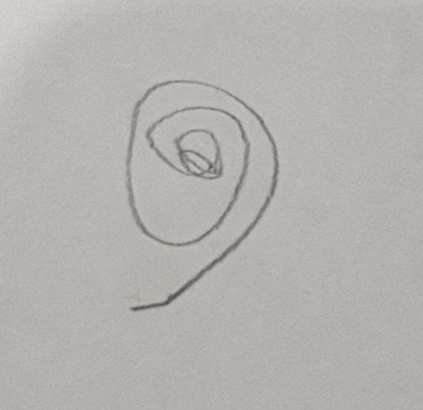

# Lucas Academy Video Lab

This repo is a small video lab for Lucas Academy lessons.

Two ways to make a video live here, and they are different in kind. The Remotion
compositions below are **deterministic** -- the code draws exactly what it says.
`t2v/` and `comfyui/` are **generative** -- a diffusion model samples pixels from
a sentence. Both run locally on this Mac.

- [`comfyui/`](./comfyui/README.md) -- Wan 2.1 in ComfyUI: the graph, the weights
  it expects, and measured speed/memory on this machine.
- [`t2v/`](./t2v/README.md) -- the same model from the command line, so a clip can
  be scripted or batched. Shares ComfyUI's weights rather than downloading its own.
- [`voice-cover/`](./voice-cover/README.md) -- sing a Suno song in your own voice.
  [SETUP.md](./voice-cover/SETUP.md) builds the two environments and lists the patches
  that Apple Silicon needs; [WORKFLOW.md](./voice-cover/WORKFLOW.md) is the pipeline;
  [VOICE-GUIDE.md](./voice-cover/VOICE-GUIDE.md) covers recording and training a voice.
  Code lives in `rvc/` (Applio, the default) and `svc/` (Seed-VC), tools in `scripts/`.
- [`LYRIC-VIDEO.md`](./LYRIC-VIDEO.md) -- the lyric-video pipeline: forced
  alignment of the lyrics, generated and stock footage through one grade, and the
  failures worth knowing about before repeating any of it.
- [`WEEKLY-VIDEO.md`](./WEEKLY-VIDEO.md) -- 好奇新世界, the weekly film of Curious Worlds
  Weekly: one Chinese film with an English dub track, live product recordings
  (`scripts/weekly/capture.cjs`), a shot list per episode, and the weekly steps.
- [`MINIMAX-VIDEO-EXPERIENCE.md`](./MINIMAX-VIDEO-EXPERIENCE.md) -- reusable
  MiniMax video-generation experience: credential location (no secrets), API
  workflow, reference-frame geometry, prompting, quota safeguards, and real
  validation results and limitations. Read before starting another video project.
- [`FAMILY-AI-LAB-01.md`](./FAMILY-AI-LAB-01.md) -- the perceptron experiment film.
  Its owner-approved delivery is one picture with simple English labels and Louise
  narration: English plays by default, with a separate Chinese audio track. The v2
  opening travels into a retro screen, where the remaining S1 shots play. The MP4
  has no subtitles or reserved caption strip; English/Chinese SRTs are separate files.
  [Production notes](./docs/family-ai-lab-01/production.md) record the original experiment
  selection, media backup and `fal01:*` commands.
- [`FAMILY-AI-LAB-02.md`](./FAMILY-AI-LAB-02.md) -- the owner's thin-pipe story:
  two friends encode an invitation, find a hidden gift with yes/no questions and
  identify its snack. Animated characters and code-derived beads/trees/boxes,
  English default narration, independent Chinese audio and external SRTs.
- [`CURIOSITY-BUILDS.md`](./CURIOSITY-BUILDS.md) -- Curiosity Builds v10 的文字归档：
  最终脚本、画面代码、字幕、素材来源、封面提示词与制作经验。为清理磁盘而保存，
  不包含视频、音频或图片；记录了日后重做所需的输入及无法保证原样恢复的部分。
- [`ROMANTICISM-MUSIC-GALLERY.md`](./ROMANTICISM-MUSIC-GALLERY.md) -- 山、海、人间:
  the approved instrumental gallery film, six portrait shorts, private-upload
  skill, source credits and the dependency-aware cleanup inventory.

## Scripts and narration

The owner's rule (2026-10-24) replaces every earlier default for how a film's words are written and voiced:
「以前的文案逻辑都要推翻，太客观、太讲事实，不是不好，但是不亲切，AI 味道太重。」 The full standard is
[SCRIPT-AND-VOICE.md](./SCRIPT-AND-VOICE.md). In short:

- **Yancy tells it, in the first person.** The script is Yancy's: written by Yancy, or spoken by Yancy and
  transcribed with the wording kept. When Claude drafts, it writes in Yancy's first person from things Yancy
  has actually said, and Yancy's edits win. The voice is Yancy's clone, `yancy/zh`.
- **Warm and personal, not a report.** Start from a moment, a person, or something that happened, not from
  figures. Use few facts, and keep the sources in the plan rather than in the narration. There is no fixed
  ending.
- **Claude analyses the script before voicing it.** Claude writes a voice-direction sheet,
  `docs/<film>/voice-direction.md`, in the format of the Language Bridge one: per line, what the line does,
  its emphasis, punctuation, spoken respellings, pause and risks. Then one whole section (about a minute) is
  voiced for Yancy to approve before the rest.
- **Faster.** Instructions no longer ask for a slow delivery. The base speed is picked by ear at the next
  film, from 1.2 / 1.3 / 1.4 (the Language Bridge Chinese film plays at 1.3×). Films delivered before this
  rule keep their recorded narration.

## YouTube covers

The owner's rule (2026-10-06): a cover carries **one question and nothing else**. That is the
film's title asked as a question, big in the film's language, with the same question small in
English when the film also serves English viewers. There is no Lucas Academy name, lesson tag,
subtitle or byline on the cover; that belongs inside the film, on its opening title card
("By Lucas Academy Team", or the authors' names when the owner gives them). Before designing a cover, agree on the question with the owner. He
prefers question-form titles, and a short list of options helps.

Example: `VgWhyCover` puts 「梵高为什么 / 画他们？」 and "Why Did Van Gogh Paint Them?" over the
film's first painting ([VG-WHY-PAINT-THEM.md](./VG-WHY-PAINT-THEM.md)). The re-made whole-person
films (2026-10-06) follow the rule too: the cover asks 「孩子说“不”，你怎么办？」, and the film opens on the
same question with Lucas Academy, the film's name and the byline added.

A series cover adds one thing (owner, 2026-10-20): the series name on a diagonal ribbon across the
top-right corner, on the cover only, never inside the film. 好奇新世界 / Curious Worlds is the first
(`WeeklyCover`, [WEEKLY-VIDEO.md](./WEEKLY-VIDEO.md)); 从新闻看教育 / Lessons from the Headlines is the
second (`Ribbon` in `src/videos/news-education-01/NewsEducation01Video.tsx`, whose `a` prop moves the
band along the corner so longer names fit).

Updated 2026-10-21:

- **One language per cover.** The zh cover is all Chinese and the en cover is all English; a
  film for both audiences gets two covers, never one bilingual cover. This replaces the
  "same question small in English" line above. The series ribbon follows the cover's language
  too: 「从新闻看教育」 on the zh cover, "Lessons from the Headlines" on the en cover.
- **Series are not numbered.** 从新闻看教育 never carries 1, 2, 3, on the cover, the title card,
  the YouTube title or the description. The `-01` in file names is an internal id only.

Exception (owner, 2026-10-27): 中英阅读 covers say 双语朗读 big with the film's title small and a clean seal, no
question and no ribbon ([ZHONG-YING.md](./ZHONG-YING.md) §Cover).

Updated 2026-11-03 (听得见的舞, `scripts/gymnopedies/cover.py`):

- **Keep the picture's composition.** Put the title in the picture's open space, using the thirds grid, or exactly
  where the owner marks it on a screenshot; never recompose the picture to clear a spot (「不要改变原始构图」). If the
  title has to sit over a busy background, soften that background a little behind a sharp subject (`dof()` cuts the
  dancer out with GrabCut and blurs the rest) instead of moving anyone.
- **Hands stay whole.** No figure's hand is cut by the cover's edge or covered by the title.

## Continuous footage and speed curves

The owner's rule (2026-10-07): compress a long continuous recording as **one unbroken
take on a smooth speed curve**. Slow down at the moments named by the narration and
speed up between them. Match the keys to each language's word timings, keep source
time moving forward, and keep the usable span clear of the recording's fades and black.

Reuse the `ramp` visual in `src/videos/fun-informatics-01/shots.ts` and the shared cubic
Hermite interpolation in `src/lib/timeRamps.ts`. A montage is appropriate for separate
scenes; a continuous transformation or game recording must retain its continuity.

## YouTube tags

The owner's rule (2026-10-07): every tag is **lowercase**, and every film carries the default set

    #education #parenting
    #art #arthistory #stem
    #bilingual #bilingualchildren #lucas_academy

(#christianeducation was a default until the owner dropped it on 2026-11-03; a film about Christian
education adds it as its own tag.)

in two places: the hashtag line that ends the description, and the Studio tags field. Both are written as
hashtags, `#` and the tag with no spaces inside, one space between (owner, 2026-11-03), so `erik satie`
becomes `#eriksatie`. A film adds a few lowercase topic tags of its own. In the hashtag line they come
after the defaults, because YouTube shows a description's first three hashtags (#education
#parenting #art) above the title; more than 60 hashtags and YouTube ignores them all. In
the tags field they come first, and the field holds 500 characters.

The set lives in [`scripts/youtube_tags.py`](./scripts/youtube_tags.py); every description generator
(`scripts/*/youtube.py`, `scripts/reciprocal-doors-youtube.py`) should take its hashtags and tags from it,
so changing the defaults is one edit, and write the whole-person layout: 【标题 / Title】, 【简介 / Description】
(ending in the hashtags), 【标签 / Tags】 and 【上传设置 / Upload settings】.

**The final output standard (owner, 2026-11-20: 「要带tags，简介最开始就是分章节」).** Every upload text has
【标签】, and its 简介 **starts with the chapters**:
- the first line is `0:00 …`;
- there are at least three chapters, in order, each at least 10 s long, all inside the film (YouTube's own
  chapter rules);
- then come the intro, sources, credits and byline, and last the hashtag line.

Films before this date put the intro first and the 「章节」 block in the middle; they keep it. New films build
the text with [`scripts/youtube_text.py`](./scripts/youtube_text.py) (`upload_text(...)`). It puts the chapters
first and refuses chapters that YouTube would reject. Shorts have no chapters.

Before a Desktop 「<片名>-上传」 folder is handed over, `.venv-align/bin/python scripts/qa/qa.py upload <folder>`
checks it against this standard:
- chapters, tags and hashtags;
- the layout;
- covers at 1280×720 and under 2 MB;
- both SRTs for a narrated film;
- nothing but upload files in the folder;
- every mp4 passed the automatic checks (README "Automatic checks").

## Narration voices

**Replaced for new films on 2026-10-24** by [SCRIPT-AND-VOICE.md](./SCRIPT-AND-VOICE.md): Yancy (`yancy/zh`),
in the first person, at a faster speed. The table below is kept for re-making the films that used it. The rule on
numbers at the end of this section still holds.

The owner's standard (2026-10-07): three voices, each with one delivery, kept in
[`scripts/voice_defaults.py`](./scripts/voice_defaults.py). A film's narration script writes them into
every line (lucas-narrate's per-line `instruct`, `mode` and `speed`), so a finished film stays
reproducible; a film overrides the instruction only when it has a reason to.

| Voice | Mode | Speed | Instruction | Chosen in |
|---|---|---|---|---|
| `fangfang/zh` | zero-shot cloning | 1.15 | none: the tone is the reference recording's | 「你可以用剪刀画画吗？」 (Matisse) |
| `louise/zh` | zero-shot-instruct | 1.0 | 请用好奇、慢慢探索的语气，像带着孩子一起发现一样说。 | Fun Informatics 1 |
| `louise/en` | zero-shot-instruct | 1.0 | "Please speak in a curious, unhurried voice, like discovering something together with a child." | Fun Informatics 1 |

`zero-shot-instruct` keeps the reference recording's rhythm and adds the instruction; `instruct` keeps
only the timbre and lets the instruction carry the delivery. The Van Gogh House demo's English
(instruct, "a lively, warm educational adventure guide") was tried as the `louise/en` default and was
too lively and too fast across a whole film (2026-10-08), so English is back to the curious, unhurried
delivery. A default fixes the style, not the
reading of every word: a polyphone (落 read là, 量 read liàng) still needs the film's own spoken
respelling (洛, 梁), and every take still gets a Whisper check.

Numbers for a Chinese voice are written out in 汉字, and **a zero is always 零, never 〇** (owner, 2026-10-20). The
voices do not know 〇: 「二〇二六年十月」 came out garbled and was heard as 「这课 26 年」. A script and its captions may
keep 〇 (二〇二六年); the film's narration builder swaps in 零 for what the voice reads, as it does for any other
spoken respelling. Years are read digit by digit (二零二六年, 一九九一年), other numbers as quantities (一千四百).

## Music under narration

The owner's rule (2026-10-16): the music **audibly makes room whenever a voice comes in**, and comes back
as soon as it stops: in every gap between lines, not only in long pauses. `scripts/music_ducking.py` holds the
defaults. The music sits 20 dB under the voice while someone speaks (the narration, or a real recording in the
film). In any gap of 0.8 s or more it rises to 9 dB under the voice. It steps back 0.35 s before a voice starts
and returns over 0.8 s after it ends. Shorter gaps stay down, so the music does not pump between phrases. A
listening moment can ask for no music at all (`quiet`). Timeline builders swap it in for whole-person-01's
envelope with `wp.music_envelope = music_ducking.envelope`. That older envelope raised the music only in pauses
of 2.5 s or more, so through a stretch of narration it sat at one flat level and never seemed to give way.
Films delivered before this rule (Fun Informatics 1 and 2, the whole-person films) keep their recorded mixes.

The rule covers **every mix the owner hears**, not only the delivered film: a listening preview, a voice test
with music, a part of the film sent for checking (owner, 2026-10-20, after a preview went out with the music at
one flat level: 「背景音乐怎么不因为人声减弱？」). Build any such mix from the film's timeline builder, or at least run
its cues through `music_ducking.envelope`; never lay a music bed under a voice at a fixed gain.

Example: in Fun Informatics 3 ([FUN-INFORMATICS-03.md](./FUN-INFORMATICS-03.md)) the music in the gaps now sits
about 8 dB higher than it did under the old envelope, and 3 dB lower under the voice. It stops completely around
the walkie-talkie listening tests.

## Automatic checks (自动检测)

The owner's rule (2026-11-19): **every video passes the automatic checks before Yancy sees it**. That covers
the delivered film, a preview, a part of a film sent for checking, and a short. Yancy used to catch these by
hand:
- picture: Muse clips wobbling in their first frames, a background drifting behind a fixed easel, black or
  frozen frames;
- voice: a word split in two, a phrase said twice, a stray word, a garbled tail, a click, a polyphone, can't
  heard as can, 〇;
- mix: music that never ducked.

[`scripts/qa/`](./scripts/qa/) checks all of them in one place, so a new film does not need its own check script.

The environment is `.venv-align` plus [`scripts/qa/requirements.txt`](./scripts/qa/requirements.txt) (pypinyin,
jieba, jellyfish, added 2026-11-20).

```bash
PY=.venv-align/bin/python    # Whisper + numpy + pypinyin + jieba
$PY scripts/qa/qa.py spec zhongying public/zhong-ying/<film>/timeline.json -o out/qa/<film>/qa-spec.json
$PY scripts/qa/qa.py lint out/qa/<film>/qa-spec.json      # before voicing
$PY scripts/qa/qa.py check FILM.mp4 --spec out/qa/<film>/qa-spec.json
$PY scripts/qa/qa.py check FILM.mp4 --spec … --audio FILM.zh.m4a   # an extra-language track: its own check
$PY scripts/qa/qa.py serve out/qa/<film>                   # the listening page for Yancy
$PY scripts/qa/qa.py gate FILM.mp4                         # 0 only if this exact file passed
$PY scripts/qa/qa.py gate FILM.mp4 --audio FILM.zh.m4a     # 0 only if this exact m4a passed, with this film
$PY scripts/qa/qa.py upload ~/Desktop/<片名>-上传            # the final package: chapters first, tags, covers
```

- **What it compares against.** A film's timeline builder writes a `qa-spec.json`; its format is described in
  [`scripts/qa/spec.py`](./scripts/qa/spec.py). The spec lists every spoken line with its speech times and
  SPOKEN text, the shots (footage that must move, shots that must stay still), the dissolves, the loudness
  target and the two SRTs. A film with no adapter can start from its captions with `qa.py spec srt`.
- **配音校对 (narration).** Each line is cut out of the audio the film actually plays, after speed changes,
  splices and the mix. Whisper medium listens to it, and the result is compared with the SPOKEN text.
  - Chinese is compared character by character. Where two characters differ, their toned pinyin decides, so a
    homophone Whisper picks (近卫/进位) passes and a wrong syllable or tone (拉/落) does not.
  - Digits are read out, never stripped, so a wrong number is caught. English words that only sound alike
    (quays/keys) pass, but never a number word: eight heard as eighty, sixty as sixth or million as billion is
    a wrong number and fails.
  - English contractions are expanded, so "can't" heard as "can" leaves a missing "not".
  - A second model (Whisper small) double-checks numbers, negations and the words in
    [`pitfalls.json`](./scripts/qa/pitfalls.json). Add every newly found slip to that file.
  - When medium hears one or two characters differently and small hears the script's own characters in exactly
    those places, the line passes. The 中英阅读 cuts have cases like 疑 heard as 一. These lines are not asked;
    they are listed at the bottom of the page as 「自动放过的」, because small may be guessing from its language
    prior.
  - Names and titles from the spec (`names`; English capitalised words are found automatically) differ only as
    拿不准, never as a fail. A repeat in the script that Whisper wrote once is 拿不准 too, because Whisper merges
    repeats. Poems and scripture read aloud (`free_pauses`) may pause without punctuation.
- **Three verdicts.**
  - **Fail** (I fix it before anything is sent):
    - a wrong number, or a negation lost or added;
    - extra words (a garbled tail, a stray word, a phrase said twice);
    - a pause of more than 1.2 s inside a line;
    - a pace outside 0.6–1.45× the film's own;
    - two or more differing units in a short line, or a similarity below 0.90 in a long one;
    - wrong loudness (narrated films −16 ± 0.5 LUFS, true peak ≤ −1 dBTP);
    - music that does not rise in the gaps;
    - a wrong format, or caption errors;
    - in the picture: a glitch frame, a jump, black frames, or real footage standing still. Black is excused
      only on the frames inside the spec's `planned_black`, a transition, or the film's first 0.5 s and last 1 s;
      a black stretch that runs past them fails on the part that sticks out.
  - **拿不准** (goes to Yancy's listening page):
    - one differing unit (often a name, or Whisper's own guess);
    - a pause that splits a word (座头|鲸);
    - a risky word the two models hear differently;
    - a question put to the audience, because tone cannot be machine-judged;
    - a click, or a line much louder or softer than the rest;
    - a picture that drifts back and forth or shakes.
  - **Pass.**
- **The listening page** (`qa.py serve`) shows one card per line:
  - the script, with what Whisper heard marked against it;
  - the line as the film plays it, and again with a few seconds around it;
  - 通过 / 重配 buttons and a note.

  Choices are saved to `out/qa/<film>/decisions.json`. A decision is about one recording of one line:
  - It is saved with the line's take print, a coarse picture of how that recording sounds
    ([`decisions.py`](./scripts/qa/decisions.py)).
  - The same take in a new render keeps its decision, even when the line moved or Whisper wrote it another way,
    so an unchanged line is never asked twice.
  - Another take of the same words is asked again, even when Whisper writes it the same and it is the same
    length. So is a line whose text or kind of doubt changed.
  - A byte hash cannot do this: one take reused in the four 中英阅读 cuts has different samples in each film.
    Measured 2026-11-20: the same take scores ≥ 0.93 (86 lines, also with the line's times moved or music under
    it), another recording of a line ≤ 0.68 (24 real retakes, 5 of exactly the same words). The limit is 0.90.
  - The print is coarse. A copy of one recording with its pitch or tempo changed by a few percent still counts
    as the same take.
  - Opened as a file (no server), the page keeps choices in the browser. Its 复制 button gives JSON for
    `qa.py decide out/qa/<film> --from pasted.json`.
- **The gate.** `qa.py gate FILM.mp4` passes only when:
  - the report's sha256 matches the file, and the report is a check of the film's own audio track;
  - every check that applies ran: a spec was given, the picture check ran, the narration check ran on a narrated
    film, and the spec says `music: true` or `false`;
  - nothing failed;
  - every 拿不准 is marked 通过. A package script calls `qa.require(path)` before it moves anything to the Desktop.
  A preview is not sent without a passing gate either.
- **An extra-language track** (the zh m4a beside an English film) is a second check with its own report:
  `qa.py check FILM.mp4 --audio FILM.zh.m4a`, with a spec that holds that language's lines.
  - The report records the sha256 of both files, and the m4a itself must be aac, 48 kHz, stereo and as long as
    the picture.
  - `qa.py gate FILM.mp4 --audio FILM.zh.m4a` (or `qa.require(path, audio=m4a)`) passes only for those exact
    two files.
  - Neither check passes the other's gate: a run with `--audio` never listened to the film's own track.
- **The upload folder.** `qa.py upload ~/Desktop/<片名>-上传` checks the final package (README "YouTube tags":
  chapters first, tags, covers, SRTs, only upload files, every mp4 gated, and every m4a gated against a film in
  the folder).

The thresholds are starting values, calibrated on 2026-11-20 against two sources. The first is the four 中英阅读
review cuts: each produced 2–5 拿不准 lines and no false failures. The second is known-bad cases built into the
tests. Change a threshold in its module's `T` dict, then re-run the tests:

```bash
.venv-align/bin/python scripts/qa/tests/test_rules.py       # no Whisper, never skips: number words, the
                                                            # take print, which approvals still hold
.venv-align/bin/python scripts/qa/tests/test_narration.py   # 12 cases, e.g. a phrase said twice, a garbled
                                                            # tail, a wrong number, can't→can, a flat music bed
.venv-align/bin/python scripts/qa/tests/test_picture.py     # injected jumps, wobble, drift, freeze, black, cuts
.venv-align/bin/python scripts/qa/tests/test_upload.py      # chapters first, tags, hashtags, brackets; a whole
                                                            # package and an extra-language m4a through the gate
```

Every slip Yancy still catches by ear or eye becomes a new test case, and a new entry in `pitfalls.json` when it is
a word.

## Film endings

**Retired on 2026-10-24** ([SCRIPT-AND-VOICE.md](./SCRIPT-AND-VOICE.md)): a film no longer has a fixed ending.
It may still end on a question when Yancy wants one, asked in Yancy's own words, and it no longer closes on the
「这也是我们在 Lucas Academy 一起学习、一起思考的问题」 formula. The old rule follows, for the films made under it.

The owner's rule (2026-10-07): every film **ends with an open-ended, inviting question**. It is the
last line spoken, after any easter egg and just before the end card, and it is also shown on screen.
It has no single right answer: it takes the film's idea into the viewer's own life and invites them
to keep thinking about it with us, ending on Lucas Academy as the place where we learn and think
together. Write it into the script with the other lines, so it is voiced and captioned like them.

Example, the redundancy film ([FUN-INFORMATICS-02.md](./FUN-INFORMATICS-02.md)): 「那么，在今天这个充满 AI 信息冗余的时代，你怎么分辨，这里面，有多少是新的呢？有多少是真的呢？什么是重要的呢？什么是可以忽略的呢？这也是我们在 Lucas Academy 一起学习、一起思考的问题。」

## Golden Funnel roller coaster

The completed roller-coaster film, its vertical short cut, the three approved
milestone masters, and the child-friendly English voice-over are packaged in
[`roller-coaster-final/`](./roller-coaster-final/README.md).

This is not primarily a demonstration of how quickly AI can output a golden
spiral. It begins with a real child's inquiry: an initially fuzzy idea becomes
clearer through questions and a hand-drawn image. Milestone 2 then becomes
**guided discovery**: an adult participates more actively, using comparisons,
technical vocabulary, and new constraints to help develop the child's idea. A
finished spiral could be generated in one step; the educational value is in
watching the idea become clear through inquiry and guidance.

The delivery README records the original wording of the questions and links
both the untouched uploaded sketch and the mildly enhanced copy used on
screen.

## The real inquiry

The Milestone 1 wording below is intentionally unpolished. These are the
child's questions, not retrospective prompts written after the answer was
known:

> I'm making a roller coaster from formula in xy coordinate plane, any
> interesting formula suggestions?

> can we have something make a loop?

> something like this



The idea then moved from 2D into 3D:

> 3d xyz plane like a funal shape spiraling down

Milestone 2 is collaborative guided discovery. An adult participated heavily,
using later results to introduce and compare more exact requirements: one
ribbon-like `Surface`, descending along the Y-axis, ending at `(0, 0, 0)`, and
contracting faster than a funnel but slower than a golden spiral. These
technical prompts should not all be attributed to the child. Only after that
exploration came the implementation request:

> Go ahead make it a roller coaster

The [complete source record](./roller-coaster-final/README.md#original-questions-and-source-image)
preserves the intermediate questions, the Möbius reference formula, the
funnel-versus-golden comparison, and links to both versions of the drawing.

- `final-long.mp4` — complete 16:9 film.
- `final-short-vertical.mp4` — complete 9:16 short.
- `clips/` — the three long-form milestone sources.

Generated review files belong in the ignored `out/` directory and are not
part of the final package.

The first prototype turns the Monkey Republic society simulation into a short
data-backed video. The goal is not to replace coding. It gives students another
way to see the same idea: rules shape society, and beliefs become behavior when
the world rewards them.

## Prototype

- `MonkeySociety`: a short Remotion video showing the same monkeys in two
  worlds: Win-Win Jungle and Dark Forest.
- Data comes from the sibling `snake-lab` repo, using the real Monkey Republic
  `Society` engine and current personality/world settings.
- The visual focuses on the society simulation because that is the part that
  benefits most from video.

## Run

```bash
npm install
npm run data
npm start
```

Render an MP4:

```bash
npm run render
```

The rendered file will be written to `out/monkey-society.mp4`.

## Data Source

`scripts/generate-monkey-data.mjs` imports:

- `../snake-lab/v3-coder/games/monkey-republic/society.js`
- `../snake-lab/v3-coder/public/games/monkey-republic/constants.js`
- `../snake-lab/v3-coder/public/games/monkey-republic/personalities.js`

That keeps the video aligned with the game instead of duplicating a separate
simulation.
